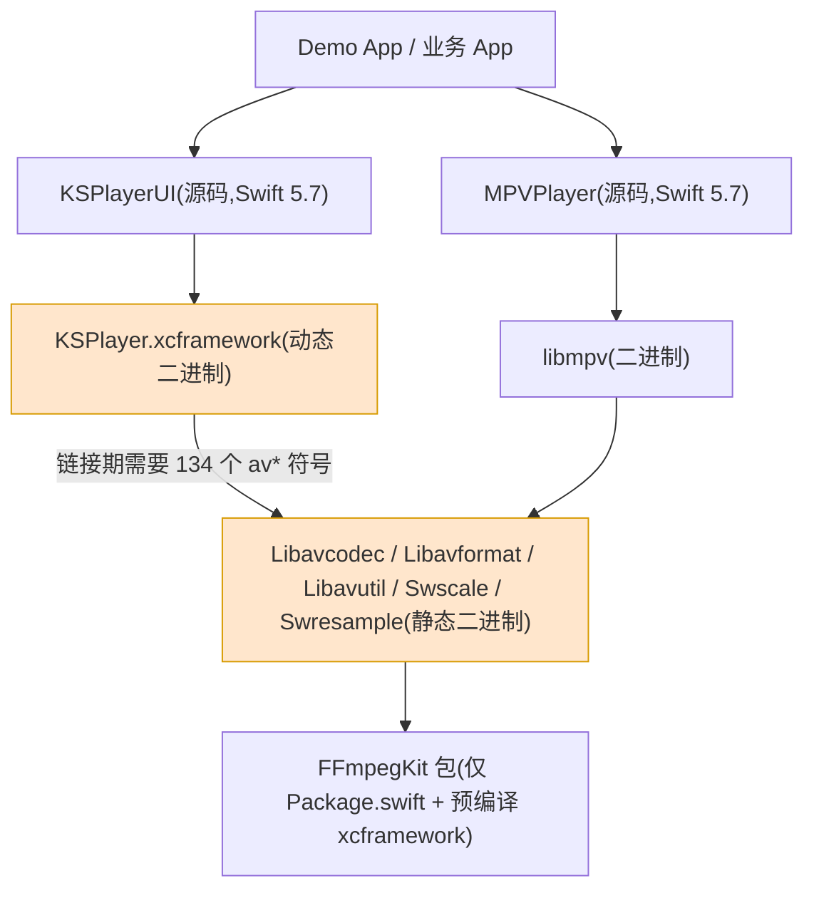
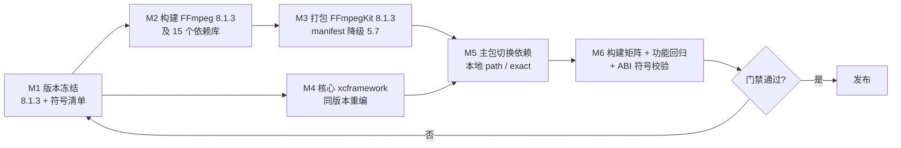

# FFmpeg 8 升级方案

| 项目 | 内容 |
|---|---|
| 文档版本 | v1.0(2026-10-28) |
| 作者 | Shiro |
| 关联文档 | [KSPlayer 迁移 Swift 5.7 详细移植方案](KSPlayer迁移Swift5.7详细移植方案.md)、[FFmpegKit 9.0.2 Swift 5.7 补丁](FFmpegKit-9.0.2-Swift5.7.patch) |
| 结论摘要 | 当前依赖已是 **FFmpeg 9.0.2**,"升级到 FFmpeg 8"实为**回退到 8.x**;且不可只换一侧二进制,必须与核心 xcframework 同版本重编 |

---

## 1. 结论先行

1. **现状核实**:[Package.swift](file:///workspace/Package.swift#L109) 依赖 `kingslay/FFmpegKit` 9.0.2,该 tag 内含的是 **FFmpeg 9.0.2**,不是 6.x/7.x。
2. 因此需求"升级到 FFmpeg 8"相对现状是**降级到 8.x**(FFmpeg 8 分支最新为 **8.1.3**)。若真实目标只是"用上更新的 FFmpeg",则**当前已满足,本方案不执行**。
3. 若确需对齐 FFmpeg 8.1.3,工作量不在本仓库的 Swift 代码,而在**二进制侧**:FFmpegKit 需自建 8.1.3 版本(官方与 kingslay 均无 8.x tag),核心 `KSPlayer.xcframework` 必须用同一份 FFmpeg 8.1.3 重新编译。
4. 三条硬约束(任一不满足都会在链接期或运行期失败):
   - 核心 `KSPlayer.xcframework` 与 `FFmpegKit` **必须是同一 FFmpeg 版本、同一 SDK 构建**;
   - 二者必须同时提供 `ios-arm64` 真机切片(现有 xcframework 缺失,见 §2.3);
   - 低版本目标(Xcode 14 / Swift 5.7)下,依赖 manifest 需为 `swift-tools-version:5.7`。

---

## 2. 现状与证据

### 2.1 当前 FFmpeg 版本(实测)

在 `kingslay/FFmpegKit` tag `9.0.2`(commit `20e3ba2`)的 xcframework 头文件中读取:

| 库 | 主版本 | 版本串 | 对应 FFmpeg 分支 |
|---|---|---|---|
| libavutil | 61 | 61.1.102 | FFmpeg 9.0.x |
| libavcodec | 63 | 63.1.102 | FFmpeg 9.0.x |
| libavformat | 63 | 63.1.102 | FFmpeg 9.0.x |
| libavfilter | 12 | 12.1.102 | FFmpeg 9.0.x |
| libswscale | 10 | 10.1.102 | FFmpeg 9.0.x |
| libswresample | 7 | 7.1.102 | FFmpeg 9.0.x |
| libmpv | — | `MPV_CLIENT_API_VERSION = 2.5` | mpv 当前主线 |

对照 FFmpeg 官方 tag 核实(见 §2.2),`libavcodec 63 / libavformat 63` 对应 `n9.0`;`n8.0` 为 `62`,`n7.1` 为 `61`。

### 2.2 版本对照表

| FFmpeg 分支 | 最新 tag | libavcodec | libavformat | libavutil | kingslay/FFmpegKit 是否有对应 tag |
|---|---|---|---|---|---|
| 6.1 | n6.1.x | 60 | 60 | 58 | 有(`6.1.x` 系列,含 libmpv) |
| 7.1 | n7.1.x | 61 | 61 | 59 | **无** |
| 8.0 | n8.0.x | 62 | 62 | 60 | **无** |
| 8.1 | **n8.1.3** | 62 | 62 | 60 | **无** |
| 9.0 | **n9.0.2** | 63 | 63 | 61 | 有(`9.0.2`,当前所用) |

kingslay 仓库 tag 全量:`9.0.2`、`6.1.4`、`6.1.3`、`6.1.2`、`6.1.1`、`6.1.0`、`6.1`、`6.0.1`、`6.0.0`;仅 `main` 分支。注意其 tag 编号与 FFmpeg 版本号一致(`6.x` → FFmpeg 6.x),**不存在 8.x 构建产物**。

### 2.3 现有二进制切片缺口

`Sources/KSPlayer.xcframework/Info.plist` 仅声明 `ios-arm64_x86_64-simulator`、`macos-arm64_x86_64`、`tvos-arm64`,**缺 `ios-arm64` 真机切片**。任何升级动作都必须顺带补齐,否则真机集成必失败。

### 2.4 耦合关系证据

核心 `KSPlayer.framework` 是动态库,但其中仍保留 **134 处** `avcodec_*` / `avformat_*` 未定义符号,由链接期从 FFmpegKit 的静态 `Libav*` 库解析。这意味着:

- FFmpeg 主版本号变化(`libavcodec 62 → 63`)会改变公共结构体布局与符号集合,核心二进制**必须同步重编**;
- 只替换 `FFmpegKit` 而不重编核心,会表现为 `Undefined symbol` 或运行期结构体越界(比编译错误更隐蔽)。

---

## 3. 版本决策

| 方案 | 目标版本 | 可行性 | 说明 |
|---|---|---|---|
| **A. 保持现状** | FFmpeg 9.0.2 | ✅ 零成本 | 满足"用上新版 FFmpeg";本方案不执行 |
| **B. 对齐 8.1.3**(若需求确指 8.x) | FFmpeg 8.1.3 | ⚠️ 需自建二进制 | 8.x 分支最新补丁版;需 FFmpegKit 8.1.3 自建 + 核心重编 |
| C. 对齐 8.0.0 | FFmpeg 8.0.0 | ⚠️ 不推荐 | 8.1.3 已含 8.0 之后全部修复,无理由停在 8.0.0 |
| D. 回退 kingslay 6.1.4 | FFmpeg 6.1.x | ❌ 不可行 | 与现有核心二进制版本差 3 个主版本,且功能回退明显 |

**建议**:先与需求方确认"FFmpeg 8"的验收口径(是"必须 8.x"还是"不低于 8.x")。若为后者,直接采用方案 A;若为前者,按方案 B 执行。

---

## 4. 依赖拓扑



**要点**:橙色两处必须同源同版本。升级 FFmpeg 版本 = 同时更换这两处。

---

## 5. 总体流程



---

## 6. 详细实施步骤

### 6.1 M1:版本冻结与符号清单

1. 冻结 FFmpeg 源码:`n8.1.3` tag(commit 以 `git ls-remote --tags` 结果为准),记录完整 commit hash。
2. 提取核心二进制依赖的 FFmpeg 符号作为**白名单**:

   ```bash
   nm -u Sources/KSPlayer.xcframework/ios-arm64_x86_64-simulator/KSPlayer.framework/KSPlayer \
     | awk '{print $2}' | grep -E '^_(av|sws_|swr_)' | sort -u > ffmpeg-symbols.txt
   ```

3. 在白名单基础上对照 FFmpeg 8.1.3 的 `libavcodec/libavcodec.map`、`libavformat/libavformat.map`、`libavutil/libavutil.map`,列出**8.1.3 中已不存在的符号**。这些符号决定了核心源码需要改动的范围。
4. 记录现有 FFmpeg 构建参数:从 FFmpegKit 9.0.2 的 `Sources/FFmpegKit/include/*_shim.h` 与各 xcframework 的 `ffbuild/config.mak`(若随包)反推 `configure` 开关,形成 8.1.3 的基线。

**验收**:`ffmpeg-symbols.txt` 与 `8.1.3 缺失符号表` 两份清单归档;缺失符号数为 0 或已完成源码侧替代方案评估。

### 6.2 M2:构建 FFmpeg 8.1.3 及依赖库

依赖库清单(与 9.0.2 保持一致,顺序即链接顺序):

| 类别 | 组件 |
|---|---|
| FFmpeg 本体 | Libavcodec、Libavdevice、Libavfilter、Libavformat、Libavutil、Libswresample、Libswscale |
| 字幕/文本 | libass、libfreetype、libfribidi、libharfbuzz、libfontconfig |
| 网络/解码 | libdav1d、libsrt、libzvbi、libopus、libssl、libcrypto |
| 渲染 | libdovi、libplacebo、MoltenVK |
| 播放器 | libmpv(`MPV_CLIENT_API_VERSION 2.5`,需选择与 FFmpeg 8.1.3 兼容的 mpv 版本) |

平台矩阵(与现有包对齐):

| 目标 | 切片 |
|---|---|
| iOS | `ios-arm64`(**本次必须新增**)、`ios-arm64_x86_64-simulator` |
| macOS | `macos-arm64_x86_64` |
| tvOS | `tvos-arm64`、`tvos-arm64_x86_64-simulator` |
| visionOS | 可选 `xros-arm64`、`xros-arm64-simulator`(需 Xcode 26 构建,Xcode 14 无能力) |

最低部署版本沿用:`iOS 13 / macOS 10.15 / tvOS 13 / watchOS 6`。

**验收**:每库每切片 `lipo -info` 架构正确;`otool -L` 无对系统外动态库的依赖;FFmpeg `av_version_info()` 运行期返回 `8.1.3`。

### 6.3 M3:打包本地 FFmpegKit 8.1.3

1. Fork `kingslay/FFmpegKit`,以 `9.0.2` 的目录结构为模板,仅替换 `Sources/*.xcframework` 为 8.1.3 产物。
2. `Package.swift` 处理(与现有 5.7 方案一致):
   - `swift-tools-version` 置 `5.7`;
   - `platforms` 移除 `.visionOS`(E2 结论:tools 5.7 下该枚举受可用性门控,任何 `#if compiler` 都无法解锁);
   - 移除 `swiftLanguageModes`;
   - 8 处 `.when(platforms: [... .visionOS ...])` 去掉 `.visionOS`。
   参考补丁:[FFmpegKit-9.0.2-Swift5.7.patch](FFmpegKit-9.0.2-Swift5.7.patch)。
3. 校验:

   ```bash
   swift package dump-package          # 5.7.3 与 6.2.4 均须 exit=0
   ```

**验收**:双工具链 `dump-package` 通过;products 清单与 9.0.2 完全一致(`FFmpegKit`、`Libav*`、`libass`、`libmpv`、`libzvbi`),否则主包 `.product(name:)` 引用会断裂。

### 6.4 M4:核心 KSPlayer 重编

前置条件(见 [§12.2](KSPlayer迁移Swift5.7详细移植方案.md)):**核心源码不在本仓库**,GPL 版仅发布动态二进制,必须由持有核心源码(或 LGPL 版)的环境执行。

1. 用 **Xcode 14.2 + Swift 5.7.2** 编译核心,FFmpeg 依赖指向 **8.1.3** 源码/产物;
2. 同时按 [KSPlayer 迁移方案](KSPlayer迁移Swift5.7详细移植方案.md) 的守卫方法论完成 Swift 5.7 语言级迁移;
3. `translationView(subtitleModel:)` 由 `package` 提升为 `public`(5.7 无 package 访问级);
4. 产出含 `ios-arm64` 的 xcframework,替换 `Sources/KSPlayer.xcframework`;
5. 记录产物 checksum 与 `swiftinterface` 头部(编译器版本、`-swift-version`、`-package-name`)。

**验收**:`swiftinterface` 头部显示 `Swift 5.7.2` 且无 `Translation`/`_Translation_SwiftUI` 依赖;`nm -u` 的 `av*` 符号全部能在 FFmpegKit 8.1.3 中找到定义。

### 6.5 M5:主包依赖切换

[Package.swift](file:///workspace/Package.swift#L93-L111) 已有"同级 `../FFmpegKit` 存在则走本地 path"的探测逻辑,切换方式二选一:

| 方式 | 做法 | 适用 |
|---|---|---|
| 本地 path(推荐先跑通) | 将自建 FFmpegKit 8.1.3 克隆到仓库同级 `../FFmpegKit` | 开发/验证阶段,零改动主包 |
| 版本锁定 | 将 `.package(url: ..., from: "9.0.2")` 改为 `exact: "8.1.3"`(需自建仓库可达) | 发布阶段 |

**注意**:此步骤属于代码变更,本方案只给方案,落地时需单独提交 PR,并按仓库白名单要求保持对外 API 不变。

### 6.6 M6:验证与门禁

| 门禁 | 方法 | 通过标准 |
|---|---|---|
| manifest 兼容 | `swift package dump-package`(5.7.3 / 6.2.4) | 均 exit=0 |
| 构建矩阵 | [build.yml](file:///workspace/.github/workflows/build.yml) 四档 Xcode(14.2 / 15.4 / 16.4 / 26.6) | 15.4 及以上全绿;14.2 需 M4 完成后再转绿 |
| 符号完整性 | `nm -u` 比对核心与 FFmpegKit | 未定义 `av*` 符号数为 0 |
| ABI 一致性 | 两版 `swiftinterface` diff | 仅允许新增,不得修改/删除既有 public 声明 |
| 运行期版本 | 打印 `av_version_info()`、`mpv_client_api_version()` | `8.1.3` / `2.5` |
| 功能回归 | §9 测试矩阵 | 全部通过 |

---

## 7. 风险矩阵

| 风险 | 概率 | 影响 | 应对 |
|---|---|---|---|
| 只换 FFmpegKit、未重编核心 → 符号缺失/结构体错位 | 高 | 运行期崩溃,难定位 | 硬性要求两侧同版本;CI 加 `nm -u` 门禁 |
| FFmpeg 8.1.3 与所选 mpv 版本不兼容 | 中 | 编译失败或播放异常 | 先做 mpv × FFmpeg 8.1.3 最小可播放验证 |
| 静态库重复符号(`FFmpegKit` 与核心各带一份) | 中 | 链接错误 | 统一由 FFmpegKit 提供,核心不内联 FFmpeg |
| visionOS 支持丢失 | 高 | visionOS 构建不可用 | 主包已移除 visionOS 平台;如需恢复,必须用 6.1+ 工具链与 8.1.3 的 xros 切片 |
| 构建耗时与包体积增加 | 中 | 集成成本 | 只保留播放所需组件,按需裁剪 libfilter/libdevice |
| 许可证合规 | 低 | 合规风险 | 确认所选组件 LGPL/GPL 组合,与现有发布声明一致 |
| 回归到 8.x 丢失 9.0 的修复/特性 | 中 | 功能差异 | 在测试矩阵中重点验证 9.0 新增解码/封装行为 |

---

## 8. 回滚方案

1. 保留 `Sources/KSPlayer.xcframework` 与 FFmpegKit 9.0.2 的原始产物与 checksum;
2. 依赖切换通过本地 path 完成,回滚即移除 `../FFmpegKit`(本地)或还原 `.package(url: ..., from: "9.0.2")`(版本锁定);
3. 发布前打 tag 快照,任一门禁失败直接 `${原 tag}` 重出。

---

## 9. 测试矩阵

| 维度 | 用例 |
|---|---|
| 容器 | MP4 / MKV / TS / FLV / WebM |
| 视频编码 | H.264 / HEVC / AV1 / VP9 |
| 音频编码 | AAC / AC3 / EAC3 / DTS / FLAC / Opus |
| 字幕 | SRT / ASS(含 libass 渲染) / 内嵌字幕轨切换 |
| HDR | HDR10 / HLG / Dolby Vision(MoltenVK 路径) |
| 网络 | HTTP(S) 点播、HLS 直播、拖拽 seek |
| 硬件解码 | VideoToolbox 开关、软解回退 |
| 播放控制 | 倍速、循环、后台、PIP、AirPlay、录屏录制 |
| 平台 | iOS 真机 / iOS 模拟器 / macOS / tvOS |
| 工具链 | Xcode 14.2 / 15.4 / 16.4 / 26.6 |

---

## 10. 未决问题(需确认后执行)

1. **验收口径**:必须"8.x"还是"不低于 8.x"?后者当前已满足,无需实施。
2. **核心源码**:M4 必须有核心源码/LGPL 版与一台 Xcode 14.2 的 Mac,否则方案无法闭环。
3. **visionOS**:是否仍需 visionOS 产物?需要则 M2 必须包含 Xcode 26 构建分支。
4. **mpv 版本配对**:libmpv 选用哪个 mpv tag(需与 FFmpeg 8.1.3 兼容),当前 `MPV_CLIENT_API_VERSION 2.5` 基线是否保持。
5. **发布形态**:自建 FFmpegKit 8.1.3 是否托管到内部 Git 仓库以便 CI 使用 `exact` 版本锁定。

---

*本文档仅给出方案,未改动任何代码;实施时按 §6 里程碑顺序推进,以 §6.6 门禁为验收标准。*
