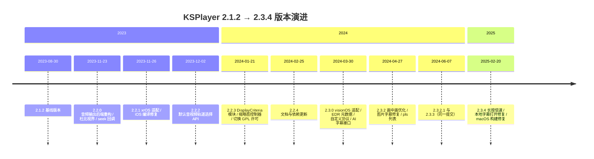

# KSPlayer 2.3.4 与 2.1.2 功能差异说明

## 文档信息

| 项目 | 内容 |
|---|---|
| 对比基线 | KSPlayer **2.1.2**（tag `2.1.2` → `32d1011`，2023-08-30） |
| 对比目标 | KSPlayer **2.3.4**（tag `2.3.4` → `bdfa2da`，2025-02-20） |
| 提交范围 | `2.1.2..2.3.4`，共 547 个提交 |
| 变更规模 | 324 个文件，+42,606 / -4,322 行（含 Demo/Pods 生成文件） |
| 数据来源 | git tag 源码树对比、提交历史、两版本 README 与 Package.swift |
| 整理 | Shiro |

> 说明：2.3.4 是官方改用二进制分发之前较晚的源码 tag（其后 2026-10 的 `072f6a2` 将核心替换为 xcframework）。本文只对比 `2.1.2` 与 `2.3.4` 两个 tag 的源码，不涉及二进制化后的变化。

## 一、版本演进时间线



各版本区间的主要定位：

| 版本 | 发布时间 | 定位与主要新增（概要） |
|---|---|---|
| 2.1.2 | 2023-08-30 | 基线：AVPlayer + FFmpeg 双内核、4K/HDR、图片字幕、PiP、录制、去隔行、空间音频、360° 全景 |
| 2.2.0 | 2023-11-23 | 音频输出后端拆分重构、杜比视界（DV）打通、seek 代理回调、TS/M3U8 seek 修复、在线字幕搜索修复 |
| 2.2.1 | 2023-11-26 | xrOS（visionOS 早期命名）适配、iOS 编译问题修复、FFmpegKit 升级 |
| 2.2.2 | 2023-12-02 | 新增默认音视频轨道选择 API、视频格式转换优化、xrOS 继续适配 |
| 2.2.3 | 2024-01-21 | 新增 `DisplayCriteria` 模块（HDR/刷新率切换）、`ThumbnailController`（进度条预览）、`preferredFrame` 开关、userAgent 配置、许可证改为 GPL/LGPL 双轨 |
| 2.2.4 | 2024-02-25 | 主要是 README/赞助列表与 FFmpeg 依赖更新，少量构建修复 |
| 2.3.0 | 2024-03-30 | visionOS ornaments 适配、tvOS 17 原生菜单、EDR/HDR 元数据、自定义 URL 协议、`AudioRecognize` 协议、`KSVideoPlayerViewBuilder`、tvOS 画中画按钮 |
| 2.3.2 | 2024-04-27 | 画中画优化、图片字幕长期问题集中修复、`MainActor` 隔离、崩溃防护、pls 播放列表支持 |
| 2.3.2.1 / 2.3.3 | 2024-06-07 | 同一提交的两个标签，构建与稳定性修复 |
| 2.3.4 | 2025-02-20 | 长按手势调节倍速、本地字幕打开修复、macOS 构建修复 |

## 二、能力结构总览

```mermaid
flowchart TB
    R["KSPlayer 2.3.4 新增能力"]
    R --> K["播放内核"]
    R --> H["HDR / 显示"]
    R --> A["音频"]
    R --> S["字幕"]
    R --> C["控制与 UI"]
    R --> N["网络 / 流媒体"]
    R --> E["工程与许可"]

    K --> K1["音视频时钟同步重构"]
    K --> K2["异步解压 / 帧数缓冲可配置"]
    K --> K3["4K 内存优化 / 泄漏修复"]
    K --> K4["低延迟直播参数"]

    H --> H1["EDR / HDR 元数据"]
    H --> H2["DisplayCriteria 刷新率与格式切换"]
    H --> H3["杜比视界链路"]

    A --> A1["四种 AudioOutput 后端"]
    A --> A2["AudioDynamicsProcessor"]
    A --> A3["空间音频声道处理"]

    S --> S1["OpenSubtitles 在线源"]
    S --> S2["字幕缓存协议层次"]
    S --> S3["图片字幕 / VTT / ASS 修复"]
    S --> S4["AudioRecognize 离线字幕接口"]

    C --> C1["缩略图 / 章节 / 播放信息"]
    C --> C2["默认轨道选择"]
    C --> C3["visionOS / tvOS17 控件"]
    C --> C4["长按倍速"]

    N --> N1["自定义 URL 协议"]
    N --> N2["pls / m3u 解析修复"]
    N --> N3["userAgent / 系统代理"]

    E --> E1["Swift 5.9 / visionOS / StrictConcurrency"]
    E --> E2["DisplayCriteria 新 target"]
    E --> E3["GPL + LGPL 双许可"]
```



## 三、按功能域详细列举

### 3.1 播放内核与性能

| 能力 | 说明 | 引入版本 |
|---|---|---|
| 音视频时钟同步优化 | 既有 `videoClockSync(main:nextVideoTime:fps:frameCount:)` 的等待与丢帧策略持续调整，减少卡顿与音画不同步 | 2.2.0 起 |
| 帧数与缓冲策略调整 | `videoFrameMaxCount` / `audioFrameMaxCount` 签名扩展并改为返回 `UInt8`（加入 `naturalSize`、`isLive` 维度）；新增 `preferredFrame` 首帧优先开关 | 2.2.0 / 2.2.3 |
| 异步解压策略调整 | 2.1.2 中 `asynchronousDecompression` 默认开启；2.3.4 增加静态全局默认（默认关闭）并支持实例覆盖，便于按设备/场景取舍 | 2.2.0 |
| 4K 与内存优化 | 多轮 4K 内存占用优化与内存泄漏修复（`2c7a99f`、`1f08ac7`、`dfb887e`、`10b7cea` 等） | 2.2.0 ~ 2.3.x |
| 像素缓冲统一抽象 | 新增 `PixelBufferProtocol`，统一 CVPixelBuffer / 自定义缓冲访问，并在协议层返回 `formatDescription` | 2.2.2 |
| 视频类型与像素格式 | 新增视频类型定义（#528）、修复 `bgr24` 无法显示、补充 YCC/色彩元数据 | 2.2.0 ~ 2.3.0 |
| 低延迟直播参数 | 新增 `nobuffer`（2.3.0）、`codecLowDelay`（2.2.0）、`seekFlags`、`userAgent`，配合低延迟策略 | 2.2.0 起 |
| 直播自适应速率 | 新增 `liveAdaptivePlaybackRate(loadingState:)` 回调，按加载状态返回自适应倍速 | 2.2.0 |
| 并发安全 | `Package.swift` 开启 `StrictConcurrency`，`MEPlayerItem` 标注 `Sendable`，UI 侧补 `@MainActor` | 2.3.0 / 2.3.2 |

### 3.2 HDR、杜比视界与显示

| 能力 | 说明 | 引入版本 |
|---|---|---|
| EDR / HDR 元数据 | 新增 `EDRMetaData`、`ContentLightMetadata`、`MasteringDisplayMetadata`、`AmbientViewingEnvironment` 等结构，FFmpeg 解码后向 Metal 渲染链路传递 HDR 静态元数据（提交 `c412762`） | 2.3.0 |
| DisplayCriteria 模块 | 新增独立 `DisplayCriteria` target，通过 ObjC 头 `AVDisplayCriteriaKS.h` 暴露 `AVDisplayCriteria(initWithRefreshRate:formatDescription:)`，按视频刷新率与格式切换显示模式 | 2.2.3 |
| 显示模式切换 | 新增 `updateVideo(refreshRate:isDovi:formatDescription:)`，结合 `avDisplayManager` 处理 Dolby Vision / HDR 动态范围；既有 `availableDynamicRange(_:)` 逻辑同步调整 | 2.2.0 ~ 2.3.x |
| 杜比视界链路 | 通过 FFmpegKit 版本切换开启 DV 解码能力（提交 `25608a6 add dv`），README 标注支持 4K/HDR/HDR10/HDR10+/Dolby Vision | 2.2.0 |
| macOS 外接屏 | 新增 `automaticWindowResize`，macOS 下按显示能力自动调整窗口 | 2.2.0 |
| 轨道色彩元数据 | `dynamicRange`、`colorPrimaries`、`transferFunction`、`yCbCrMatrix`、`colorSpace`、`bitDepth` 等字段在协议与两套内核中统一暴露并完善 | 2.2.0 ~ 2.3.0 |

### 3.3 音频

| 能力 | 说明 | 引入版本 |
|---|---|---|
| 音频后端拆分 | 内部协议 `AudioPlayer` 重命名并公开为 `AudioOutput`；新增 `AudioGraphPlayer`（AUGraph 多节点）、`AudioUnitPlayer`（AudioToolbox 直连）；既有 `AudioRendererPlayer`（AVSampleBufferAudioRenderer）改为遵循 `AudioOutput` | 2.2.0 |
| 动态音频处理 | 新增 `AudioDynamicsProcessor` 协议与 `AudioEngineDynamicsPlayer`（#584），支持音量/动态范围类音效处理 | 2.2.0 |
| 多声道 / 空间音频 | 既有 `isSpatialAudioEnabled(channelCount:)`、`outputNumberOfChannels(channelCount:)` 在新输出后端下重写声道裁剪逻辑 | 2.2.0 ~ 2.3.x |
| 音频中断与杂音修复 | 修复 `AVAudioSession` 中断后的杂音/异常（`64a902e`、`18b625c`） | 2.3.0 |
| TrueHD / 采样率 | 修复 TrueHD 播放（#639），默认采样率统一为 48000 | 2.2.0 |
| 输出协议公开化 | `OutputRenderSourceDelegate`、`FrameOutput` 等协议由 internal 提升为 public，便于自定义音视频输出后端 | 2.2.0 |

### 3.4 字幕

| 能力 | 说明 | 引入版本 |
|---|---|---|
| OpenSubtitles 在线源 | 新增 `OpenSubtitleDataSouce`；修复 OpenSubtitles 搜索无结果问题（`8736ce7`） | 2.2.0 |
| 字幕源协议分层 | 新增 `FileURLSubtitleDataSouce`、`CacheSubtitleDataSouce`，并新增 `PlistCacheSubtitleDataSouce` 持久化选中的字幕 | 2.2.3 |
| SRT 多行字幕 | 支持 SRT 多行文本（`f1e03d6`） | 2.2.0 |
| VTT 死循环修复 | 修复无序号 VTT 解析失败并进入死循环的问题（`ee4e46d`） | 2.3.2 |
| ASS 颜色与样式 | 修复 ASS 字幕颜色问题（`a248cdf`），新增 `ASSStyle` 结构；libass 完整 ASS 渲染属 LGPL 付费能力 | 2.2.0 |
| 图片字幕修复 | 连续修复图片字幕（PGS/DVB/DVD）显示与残留问题，并修复「字幕图片过大导致屏幕无法点击」 | 2.3.2 |
| 字幕 UI | 字幕居中、iPad/visionOS 字幕字号统一、`VideoTimeShowView` 支持自定义字体、字幕按钮迁移到 visionOS ornaments | 2.3.0 |
| 字幕元信息 | 名称缺失时用语言替代编解码器名称（`b6e4ab7`） | 2.2.3 |
| AI / 离线字幕接口 | 新增 `AudioRecognize` 协议（`append(frame: AudioFrame)`），为离线 AI 实时字幕生成/翻译提供音频帧输入；实现属 LGPL 付费能力 | 2.3.0 |

### 3.5 播放控制、缩略图与信息展示

| 能力 | 说明 | 引入版本 |
|---|---|---|
| 默认轨道选择 | 新增 `wantedVideo(tracks:)`、`wantedAudio(tracks:)` 可重写方法，按 `MediaPlayerTrack` 选择默认轨道 | 2.2.2 |
| 缩略图控制器 | 新增 `ThumbnailController`、`FFThumbnail`、`ThumbnailControllerDelegate`，基于 FFmpeg 异步抽帧（`async throws` + 进度回调），用于进度条预览 | 2.2.3 |
| 章节 | 新增 `Chapter` 结构与 `chapters` 协议属性，AVPlayer 与 FFmpeg 内核均接入（原有 `thumbnailImageAtCurrentTime()` 单帧接口继续保留） | 2.2.3 |
| 播放信息面板 | 新增 `DynamicInfo`（`ObservableObject`），暴露码率、FPS、音画同步差、丢帧/丢包数、已读字节数；配套 `DynamicInfoView` | 2.2.0 |
| seek 回调 | 新增 seek 代理回调（`b747011`）；新增「停留 3 秒后自动 seek」（`fc83aa3`）与可 seek 判断（`3d9b25f`） | 2.2.0 / 2.3.0 |
| 录制 | 新增录制入口（`startRecord`，`71fde5c add record func`） | 2.2.3 |
| 画中画 | tvOS 新增 PiP 按钮（`a7d1732`）、visionOS 隐藏 PiP、新增 `canStartPictureInPictureAutomaticallyFromInline` 静态开关、2.3.2 集中优化 PiP 状态切换 | 2.3.0 / 2.3.2 |
| 倍速手势 | 长按手势调节播放速率（`6d8645d`） | 2.3.4 |

### 3.6 网络、流媒体与自定义协议

| 能力 | 说明 | 引入版本 |
|---|---|---|
| 自定义 URL 协议 | 新增 `AbstractAVIOContext` 与 `KSOptions.process(url:) -> AbstractAVIOContext?`，支持 nfs / smb / UPnP 等自定义协议（提交 `4653aa7`） | 2.3.0 |
| 播放列表 | 新增 pls 解析（`e07eaf9`）、修复 m3u 无法解析（`150207b`）、新增 M3U 解析测试 | 2.2.3 / 2.3.2 |
| seek 稳定性 | 修复 M3U8 拖进度条黑屏（`2f00ad9`）、修复 TS seek（`5def1ff`） | 2.2.0 |
| 链接兼容 | 修复百度网盘视频链接无法播放（`d1d3fba`，2.3.2）、修复本地字幕打开失败（2.3.4） | 2.3.2 / 2.3.4 |
| 请求控制 | 新增 `userAgent`（默认 `KSPlayer`，`b3c44d7`，2.2.3）与 `useSystemHTTPProxy`（2.3.0） | 2.2.3 / 2.3.0 |
| 直播能力 | README 标注低延迟 4K 直播（局域网 <200ms）与按网络自动切换多码率流 | 2.3.4 |

### 3.7 UI / SwiftUI / 多平台

| 能力 | 说明 | 引入版本 |
|---|---|---|
| visionOS 适配 | `Package.swift` 正式启用 `visionOS(.v1)`（2.1.2 中为注释状态）；播放控件改为 ornaments；新增玻璃背景效果、隐藏 visionOS 不适用的 PiP 按钮、标题/倍速/字幕/填充模式迁移至 ornaments | 2.3.0 |
| tvOS 17 菜单 | 使用 tvOS 17 原生菜单重构控制按钮，新增控制器背景（`eacd057`、`571fce0`） | 2.3.0 |
| 视图构建器 | 新增 `KSVideoPlayerViewBuilder`（SwiftUI result builder），统一播放器视图组合方式 | 2.3.0 |
| 通用组件 | 新增 `PlatformView`（2.2.0）、`DynamicInfoView`（2.2.0）、`MenuView`（2.2.3）、`Either`（2.3.0）等 UI/工具类型 | 2.2.0 ~ 2.3.0 |
| 交互细节 | 音量滑块、播放/暂停过渡动画、字幕居中、tvOS 进度条与滑动手势修复、手势丢失修复、macOS UI 优化 | 2.3.0 |
| 平台声明 | `Package.swift` 新增 `.macCatalyst(.v13)` 与 `.visionOS(.v1)` | 2.3.0 |

### 3.8 工程、构建与许可

| 变更 | 说明 |
|---|---|
| SwiftPM 工具链 | `swift-tools-version` 由 5.7 提升到 5.9；开启 `StrictConcurrency` 实验特性 |
| 新增 target | 新增 `DisplayCriteria` target（ObjC 私有 `AVDisplayCriteria` 接口），同时提供 `DisplayCriteria.podspec` |
| 依赖 | FFmpegKit 由 `6.0.1` 提升到 `6.1.3`；CocoaPods/SwiftPM 依赖解析与本地路径查找修复；示例工程 Pods 从 OpenSSL 切换为 Libass 等 |
| 许可证 | 2.2.3（2024-01）起改为 **GPL v3（免费）+ LGPL（付费）** 双轨（`c879430 change license`） |
| 测试 | 新增 `M3UParseTest`、`SubtitleTest` |
| 日志 | 重构 `KSLog`：分级日志、`@autoclosure`、`dso` 重载 |
| 隐私材料 | 新增隐私政策、服务条款等文档 |

## 四、关键新增类型 / API 清单

| 类型或 API | 模块与文件（2.3.4） | 用途 | 引入版本 |
|---|---|---|---|
| `AudioOutput`（原内部协议 `AudioPlayer` 公开重命名）、公开化的 `FrameOutput` / `OutputRenderSourceDelegate`、新增 `VideoOutput` 协议 | `MEPlayer/` | 音视频输出统一协议 | 2.2.0 |
| `AudioGraphPlayer` | `MEPlayer/AudioGraphPlayer.swift` | AUGraph 多节点音频输出（含动态处理节点） | 2.2.0 |
| `AudioUnitPlayer` | `MEPlayer/AudioUnitPlayer.swift` | AudioToolbox 轻量音频输出 | 2.2.0 |
| `AudioRendererPlayer` | `MEPlayer/AudioRendererPlayer.swift` | 基于 AVSampleBufferAudioRenderer 的音频输出（2.1.2 已存在，2.2.0 起遵循 `AudioOutput`） | 2.2.0 重构 |
| `AudioDynamicsProcessor` / `AudioEngineDynamicsPlayer` | `MEPlayer/AudioEnginePlayer.swift` | 音频动态处理 | 2.2.0 |
| `PixelBufferProtocol` | `Metal/PixelBufferProtocol.swift` | 像素缓冲统一抽象 | 2.2.2 |
| `DisplayCriteria` 模块 | `Sources/DisplayCriteria/` | HDR/刷新率显示模式切换 | 2.2.3 |
| `ThumbnailController` / `FFThumbnail` | `MEPlayer/ThumbnailController.swift` | 进度条缩略图抽帧 | 2.2.3 |
| `EDRMetaData` / `ContentLightMetadata` / `MasteringDisplayMetadata` / `AmbientViewingEnvironment` | `MEPlayer/Model.swift` | HDR 元数据 | 2.3.0 |
| `AbstractAVIOContext` + `KSOptions.process(url:)` | `Core/` | 自定义 URL 协议 | 2.3.0 |
| `AudioRecognize` | `Subtitle/AudioRecognize.swift` | 离线 AI 字幕输入协议 | 2.3.0 |
| `KSVideoPlayerViewBuilder` | `SwiftUI/KSVideoPlayerViewBuilder.swift` | SwiftUI 播放器视图构建器 | 2.3.0 |
| `Chapter` + `chapters` | `AVPlayer/MediaPlayerProtocol.swift` | 章节信息 | 2.2.3 |
| `DynamicInfo` / `DynamicInfoView` | `AVPlayer/MediaPlayerProtocol.swift`、`SwiftUI/` | 播放统计信息面板 | 2.2.0 |
| `OpenSubtitleDataSouce` | `Subtitle/SubtitleDataSouce.swift` | OpenSubtitles 在线字幕 | 2.2.0 |
| `PlistCacheSubtitleDataSouce` | `Subtitle/SubtitleDataSouce.swift` | 字幕选择持久化缓存 | 2.2.3 |
| `wantedVideo(tracks:)` / `wantedAudio(tracks:)` | `AVPlayer/KSOptions.swift` | 默认轨道选择 | 2.2.2 |
| 去隔行 idet 自动检测 | 按画面内容判定 `tff` / `bff` / `progressive`，自动选择 `yadif` / `yadif_videotoolbox`（提交 `fe93c39`） | 2.3.0 |
| `startRecord(url:)` | `MEPlayer/KSMEPlayer.swift` | 视频录制 | 2.2.3 |
| `preferredFrame`、`useSystemHTTPProxy` | `AVPlayer/KSOptions.swift` | 首帧优先、系统 HTTP 代理开关 | 2.2.3 / 2.3.0 |

## 五、README 能力矩阵变化（2.1.2 → 2.3.4）

2.1.2 的 README 只有一份功能勾选列表；2.3.4 改为 **GPL（免费）/ LGPL（付费）** 对照矩阵：

**两版本都具备（GPL 也可用）**
- 录制视频、360° 全景视频、画中画、硬件加速、无缝循环播放、去隔行自动检测
- 4K / HDR / HDR10 / HDR10+ / Dolby Vision
- 自定义 URL 协议（nfs / smb / UPnP）
- 多声道 / 空间音频
- 文本字幕 / 图片字幕 / 隐藏字幕（CC）
- 在线字幕搜索（shooter / assrt / opensubtitles）
- 低延迟 4K 直播（局域网 <200ms）、按网络自动切换多码率

**仅 LGPL 付费版本标注具备（GPL 源码中不可用或受限）**
- Dolby AC-4 解码
- AV1 硬件解码
- 全量 demuxer / decoder
- 任意片段录制
- 流畅播放 8K / 120 FPS
- Dolby Vision P5 显示 HDR（不过热）
- 直播回看 / 进度回退
- 画中画支持字幕显示
- 全平台蓝光播放
- Annex-B 异步硬件解码（直播流）
- 使用视频内嵌字体渲染字幕
- 短时间范围内存缓存快速 seek
- 硬盘缓存 / 预加载
- 离线 AI 实时字幕生成与翻译
- libass 完整 ASS 特效渲染
- App 内小窗播放（可恢复）
- FFmpeg 7.0.2（GPL 版为 6.1.0）

## 六、结论与注意事项

1. **内核侧最实质的进步**：音视频时钟同步与缓冲策略可配置化、异步解压、4K 内存优化、低延迟直播参数、自定义 URL 协议、EDR/HDR 元数据链路与 DisplayCriteria 显示模式切换。
2. **功能侧最直观的新增**：`OpenSubtitles` 在线字幕、缩略图/章节/播放信息面板、默认轨道选择、录制入口、visionOS/tvOS 17 新控件、长按倍速、AI 字幕输入协议。
3. **兼容性修复集中在**：图片字幕、VTT 解析、M3U8/TS seek、音频中断杂音、画中画状态、macOS/iOS 构建。
4. **许可与分发变化**：2.2.3 起改为 GPL/LGPL 双轨；README 矩阵中大量高级能力仅 LGPL 版本提供，源码仓库中无法直接获得完整实现。评估迁移时需同时确认目标版本与授权版本。
5. **统计口径**：上述 `+42,606` 行包含 Demo/Pods 等生成文件与三方依赖清单，不代表核心源码净增量。

## 附录：复现命令

```bash
# 拉取两个版本的 tag
git fetch --tags origin

# 查看提交与文件规模
git rev-list --count '2.1.2^{}..2.3.4^{}'
git diff --stat '2.1.2^{}' '2.3.4^{}'

# 查看某能力引入的版本
git log --diff-filter=A --format='%h %ci' '2.3.4^{}' -- Sources/KSPlayer/MEPlayer/ThumbnailController.swift
git tag --contains <commit> | sort -V | head -1

# 查看历史版本文件内容
git show '2.3.4^{}:Sources/KSPlayer/MEPlayer/AudioGraphPlayer.swift'
git show '2.1.2^{}:Sources/KSPlayer/Subtitle/SubtitleDataSouce.swift'
```
