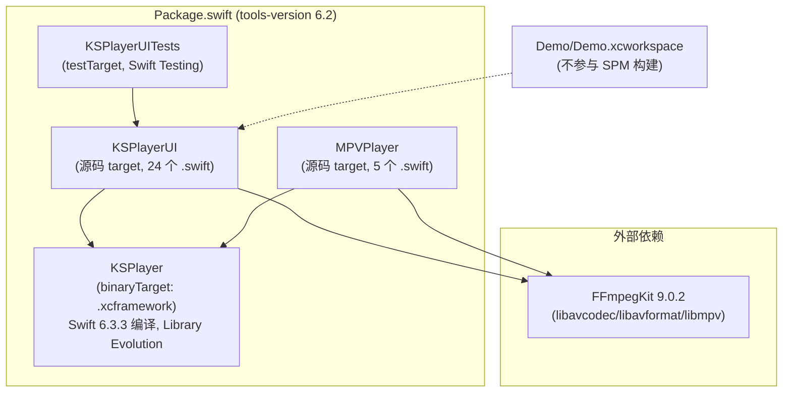
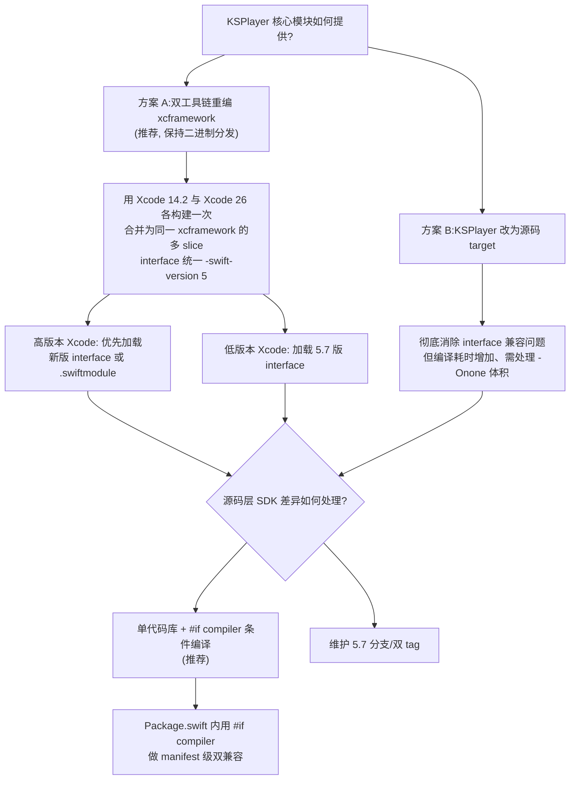
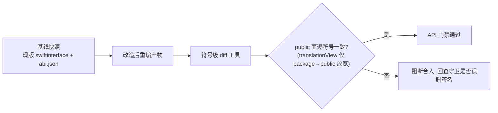

# KSPlayer 迁移 Swift 5.7 详细移植方案

> 作者:Shiro
> 日期:2026-10-28
> 分支:`trae/agent-0tsa5E`(基于 main @ 7d6b4ce)
> 目标:在**不改变任何对外暴露 API(方法签名、类型、访问级别、默认参数)**、且**功能行为与 main 分支完全一致**的前提下,使本工程可同时被 **Swift 5.7 / Xcode 14.0–14.2(低版本)** 与现有 **Swift 6.x / Xcode 15–26(高版本)** 编译使用。
>
> 基线说明:已核实 `git diff main..HEAD` 仅含本文档差异,**main 分支与当前分支代码逐字节一致**,故"功能与 main 分支一致"即"与现状代码功能一致",以现状代码为唯一功能基线(详见 §6.2)。

---

## 目录

1. [背景与目标](#1-背景与目标)
2. [现状分析](#2-现状分析)
3. [Swift 5.7 兼容性差距分析](#3-swift-57-兼容性差距分析)
4. [移植总体方案](#4-移植总体方案)
5. [逐文件改造清单](#5-逐文件改造清单)
6. [对外 API 与功能一致性的保障措施](#6-对外-api-与功能一致性的保障措施)
7. [Xcode 兼容矩阵与 CI 改造](#7-xcode-兼容矩阵与-ci-改造)
8. [实施步骤与里程碑](#8-实施步骤与里程碑)
9. [风险与缓解](#9-风险与缓解)
10. [附录:验证命令](#10-附录验证命令)

---

## 1. 背景与目标

### 1.1 背景

当前分支的构建配置为 `swift-tools-version:6.2`(见 [Package.swift](../../Package.swift)),核心模块 `KSPlayer` 以 **Swift 6.3.3 编译器产出的二进制 xcframework** 形式分发,UI 与 MPV 模块为源码 target。CI([build.yml](../../.github/workflows/build.yml))固定在 `macos-26` + `Xcode_26.6` 上构建。

大量仍在使用 Xcode 14.x(Swift 5.7 工具链)的业务方无法集成本工程,需要一套**单代码库、双工具链共存**的移植方案。

### 1.2 硬性约束

| 约束 | 说明 |
|---|---|
| **API 零变更** | 所有 `public`/`open` 声明的签名、默认参数、`@available` 标注、访问级别对高版本 Xcode 用户保持逐字节兼容 |
| **功能与 main 分支一致** | 移植仅增加编译期守卫(`#if compiler`)与构建配置条件化,**不修改任何函数体、条件表达式、分支逻辑**;运行时行为以 main 分支代码为唯一基线,逐功能域等价(见 §6.2) |
| **低版本可用** | Xcode 14.0–14.2(Swift 5.7)可 `swift build` / SPM 集成 / 编译通过 |
| **高版本不回退** | Xcode 15–26 下行为与现在一致,新 SDK 上的 iOS 17/26 视觉特性仍生效 |
| **不破坏二进制兼容** | KSPlayer 模块已开启 Library Evolution,重编后仍需保持 `.abi.json` 稳定 |

### 1.3 目标平台

iOS 13+ / macCatalyst 14+ / macOS 10.15+ / tvOS 13+;visionOS 仅在 Xcode 15+ 下提供(5.7 工具链不存在 visionOS 平台,这是**平台级差异**,不属于 API 破坏,详见 §4.5)。

---

## 2. 现状分析

### 2.1 工程结构



- 源码规模:`Sources/KSPlayerUI` + `Sources/MPVPlayer` + `Tests` 共 **35 个 Swift 文件、13 824 行**。
- 对外 API 面:源码侧 **369 个 public/open 声明**(不含 KSPlayer 二进制模块自身数百个 public 声明)。
- 资源:`Sources/KSPlayerUI/Localizable.xcstrings`(String Catalog,67 个 key)。

### 2.2 工具链与语言配置现状

| 配置项 | 当前值 | 引入版本 |
|---|---|---|
| `swift-tools-version` | `6.2` | Xcode 26 |
| `swiftLanguageModes` | `[.v5, .v6]` | tools 5.9+ |
| `.visionOS(.v1)` 平台 | 有 | tools 5.9+(Xcode 15) |
| `-experimental-package-interface-load` unsafeFlag | 3 处 | Swift 5.9 实验特性 |
| `Localizable.xcstrings` 资源 | `.process` | Xcode 15+ |
| Swift Testing(`import Testing`) | 测试 target | Xcode 16+ |
| `.swiftformat --swiftversion` | `6.3` | — |
| CI | `macos-26` / Xcode 26.6 | — |

### 2.3 二进制框架 KSPlayer.xcframework 现状(核心阻塞点)

以 [arm64-apple-ios-simulator.swiftinterface](../../Sources/KSPlayer.xcframework/ios-arm64_x86_64-simulator/KSPlayer.framework/Modules/KSPlayer.swiftmodule/arm64-apple-ios-simulator.swiftinterface) 为例,头部为:

```
// swift-compiler-version: Apple Swift version 6.3.3 (swiftlang-6.3.3.1.3 clang-2100.1.1.101)
// swift-module-flags: -target arm64-apple-ios13.0-simulator -enable-objc-interop
//   -enable-library-evolution -swift-version 6 -O
//   -enable-experimental-feature DebugDescriptionMacro
//   -module-name KSPlayer -package-name ksplayer
import Foundation/*.Bundle*/
import Foundation/*.ProcessInfo*/
import Foundation/*.URL*/
```

Swift 5.7 加载该 interface 会失败的 **4 个独立原因**:

1. **`-swift-version 6`**:5.7 的 language mode 只到 5,解析 module flags 直接报错;
2. **选择性 import 语法 `import Foundation/*.Bundle*/`**:Swift 6.3 新引入的 interface 语法,5.7 词法分析器无法解析;
3. **`-enable-experimental-feature DebugDescriptionMacro`**:未知实验特性,非 ignorable 区段;
4. **interface 体内引用 iOS 18 API**(`AVDelegatingPlaybackCoordinator` 及其 4 个 Command 类型):Xcode 14 SDK(iOS 16.4)中这些符号不存在,interface 校验失败。

此外,`package.swiftinterface` 中含 1 个 `package` 访问级符号:

```swift
@_Concurrency.MainActor @preconcurrency package func translationView(subtitleModel: KSPlayer.SubtitleModel?) -> some SwiftUICore.View
```

被 [KSCorePlayerView.swift L46](../../Sources/KSPlayerUI/SwiftUI/KSCorePlayerView.swift) 使用。`package` 访问级是 **Swift 5.9** 特性,5.7 下 `package.swiftinterface` 文件本身不存在、该符号不可见 → KSPlayerUI 编译失败。这正是当前加 `-experimental-package-interface-load` 的原因。

**结论:现有 xcframework 在 Xcode 14 下 100% 不可用,必须用 Swift 5.7 工具链重新产出(或改为源码分发),这是整个移植方案的第一优先级。**

### 2.4 源码语言特性盘点

对 `Sources/`、`Tests/` 全量扫描结果:

| 特性 | 最低 Swift 版本 | 使用情况 |
|---|---|---|
| `async/await`、`Task`、`@MainActor`、`Sendable`、`@unchecked Sendable` | 5.5 | ✅ 大量使用,**5.7 支持,无需改动** |
| `any` 存在类型、不透明结果类型、primary associated types | 5.6/5.7 | ✅ 兼容 |
| 正则字面量、多语句宏 | 5.7 | 未使用 |
| `if #unavailable` | 5.8 | ❌ 未使用 |
| `package` 访问级 | 5.9 | ❌ 源码未使用(仅二进制 interface 内 1 处) |
| `@Observable`、`#Preview`、`nonisolated(unsafe)`、`consume`/`borrowing` | 5.9/5.10 | ❌ 未使用 |
| typed throws、Swift 6 严格并发强制 | 6.0 | ❌ 源码未使用(保持 5 language mode 即可) |
| Swift Testing(`@Test`/`#expect`/`#require`) | 6.0(Xcode 16) | ⚠️ [KSPlayerResourceTest.swift](../../Tests/KSPlayerUITests/KSPlayerResourceTest.swift) 全文件使用 |

**语言语法层面几乎无阻塞**,阻塞集中在:构建系统、二进制框架、SDK API 符号存在性、`#if os(visionOS)`、资源与测试。

### 2.5 SDK API 符号存在性问题(与语言版本无关)

`if #available(...)` 只解决**运行时**分支,不解决**编译期符号不存在**。低 SDK(Xcode 14 = iOS 16.4 SDK)下,以下 API 符号不存在,即使写在 `#available` 分支内也编译失败,必须叠加 `#if compiler(>=x)` 源码级裁剪:

| API | 引入 SDK | 出现位置 |
|---|---|---|
| `#if os(visionOS)`(平台名) | Swift 5.9 编译器 | 全工程 20+ 处(如 [VideoControllerView.swift L120](../../Sources/KSPlayerUI/SwiftUI/VideoControllerView.swift)、[IOSVideoPlayerView.swift](../../Sources/KSPlayerUI/View/IOSVideoPlayerView.swift) 8 处) |
| `@FocusedObject` / `.focusedObject(_:)` | iOS 17(Xcode 15) | [ViewExtension.swift L14](../../Sources/KSPlayerUI/SwiftUI/ViewExtension.swift)、[KSVideoPlayerView.swift L135](../../Sources/KSPlayerUI/SwiftUI/KSVideoPlayerView.swift) |
| `onKeyPress(_:)` | iOS 17 | [ViewExtension.swift L338-368](../../Sources/KSPlayerUI/SwiftUI/ViewExtension.swift) |
| `contentTransition(.symbolEffect(.replace))` | iOS 17 | [KSVideoPlayerViewBuilder.swift L165](../../Sources/KSPlayerUI/SwiftUI/KSVideoPlayerViewBuilder.swift) |
| `glassBackgroundEffect()`、`ornament(attachmentAnchor:.scene)` | visionOS 1(Xcode 15) | [VideoControllerView.swift L121/127/214/239](../../Sources/KSPlayerUI/SwiftUI/VideoControllerView.swift) |
| `buttonStyle(.glass)` | iOS 26(Xcode 26) | [ViewExtension.swift L128](../../Sources/KSPlayerUI/SwiftUI/ViewExtension.swift) |
| `glassEffect(.clear)` | tvOS 26(Xcode 26) | [PlayerSlider.swift L222](../../Sources/KSPlayerUI/SwiftUI/PlayerSlider.swift) |
| `AVDelegatingPlaybackCoordinator` 族 | iOS 18(Xcode 16) | [KSMPVPlayer.swift L65-355](../../Sources/MPVPlayer/KSMPVPlayer.swift) |

注:`Task.sleep(nanoseconds:)`、`String(localized:bundle:)`、`NavigationStack`、`.formStyle(.grouped)`、`LabeledContent`、`TextField(value:format:)`、`persistentSystemOverlays` 等均为 iOS 15/16 API,**Xcode 14 SDK 已包含,无需处理**。

---

## 3. Swift 5.7 兼容性差距分析

汇总差距,按层次归类(严重度:🔴 阻塞 / 🟡 需改造 / 🟢 兼容):

| # | 层次 | 项 | 严重度 | 说明 |
|---|---|---|---|---|
| G1 | 构建 | `swift-tools-version:6.2` | 🔴 | 5.7 manifest 解析器直接拒绝 |
| G2 | 构建 | `swiftLanguageModes [.v5,.v6]` | 🔴 | 参数不存在;`.v6` 枚举值不存在 |
| G3 | 构建 | `.visionOS(.v1)` 平台枚举 | 🔴 | tools 5.9 才加入该 case |
| G4 | 构建 | `-experimental-package-interface-load` | 🔴 | 5.7 不识别该 flag,SPM 报 unknown flag |
| G5 | 构建 | `Localizable.xcstrings` | 🟡 | Xcode 14 无法编译 String Catalog |
| G6 | 二进制 | KSPlayer.xcframework(Swift 6.3.3 interface) | 🔴 | 见 §2.3,4 重原因不可加载 |
| G7 | 二进制 | `package func translationView` | 🔴 | 5.7 无 package 访问级 |
| G8 | 二进制 | interface 引用 iOS 18 API | 🔴 | Xcode 14 SDK 无符号 |
| G9 | 源码 | `#if os(visionOS)` 20+ 处 | 🔴 | 5.7 不认识 visionOS 平台名 |
| G10 | 源码 | iOS 17/18/26、visionOS 1 API 符号 | 🔴 | 低 SDK 编译失败(§2.5) |
| G11 | 源码 | Swift 6 严格并发语义 | 🟢 | 保持 5 mode 即可,源码未用 6-only 特性 |
| G12 | 测试 | Swift Testing | 🟡 | Xcode 16+;5.7 下需排除或改写 XCTest |
| G13 | 外部依赖 | FFmpegKit 9.0.2 | 🟡 | 其 tools-version 若 ≥5.9,Xcode 14 无法解析(需实测/降级/本地路径) |
| G14 | 工具 | `.swiftformat` `--swiftversion 6.3` | 🟢 | 仅影响格式化,建议按分支降为 5.7 |
| G15 | CI | 单 Xcode 26.6 | 🟡 | 无低版本回归门禁 |

---

## 4. 移植总体方案

### 4.1 方案选型



**推荐:方案 A + 条件编译 + manifest 双兼容**。理由:

- Library Evolution 已开启,`.abi.json` 存在,重编后可做 API 逐符号 diff 验证"API 不变"约束;
- 不引入第二套代码库,高/低版本 Xcode 拉同一 tag 即可用;
- 方案 B 作为兜底(若上游 KSPlayer 源码仓库无法用 Xcode 14.2 编译,如内部大量使用 5.9+ 语法,则退化为 B 或"源码 pod")。

### 4.2 Package.swift 双兼容改造(设计稿,不在本文档实施)

核心技巧:**manifest 本身也是被工具链编译器编译的 Swift 代码**,`#if compiler(>=x.y)` 在 Package.swift 中有效,可实现"一份 manifest,两代工具链各自取所需分支"。

```swift
// swift-tools-version:5.7
import Foundation
import PackageDescription

var platforms: [SupportedPlatform] = [
    .iOS(.v13), .macCatalyst(.v14), .macOS(.v10_15), .tvOS(.v13),
]
#if compiler(>=5.9)
platforms.append(.visionOS(.v1))   // G3: 仅高版本工具链存在该枚举
#endif

// G4: package interface load 仅 5.9+ 需要且可用
var uiSwiftSettings: [SwiftSetting] = []
#if compiler(>=5.9)
uiSwiftSettings.append(.unsafeFlags(["-experimental-package-interface-load"]))
#endif

let package = Package(
    name: "KSPlayer",
    defaultLocalization: "en",
    platforms: platforms,
    products: [ /* 与现状一致, 不动 */ ],
    targets: [
        .binaryTarget(name: "KSPlayer", path: "Sources/KSPlayer.xcframework"),
        .target(name: "MPVPlayer", dependencies: [...], swiftSettings: uiSwiftSettings),
        .target(name: "KSPlayerUI", dependencies: [...], resources: uiResources, swiftSettings: uiSwiftSettings),
    ]
    // G2: 删除 swiftLanguageModes; 5 mode 是 5.7 默认, 高版本同样落到 5 mode, 行为一致
)

// G5: 资源双兼容 —— 低版本用 .lproj/*.strings, 高版本用 .xcstrings
var uiResources: [Resource] = []
#if compiler(>=5.9)
uiResources.append(.process("Localizable.xcstrings"))
#else
uiResources.append(.process("Resources"))   // en.lproj/Localizable.strings 等
#endif
```

要点:

- `tools-version` 降为 `5.7` 后,高版本工具链**向下兼容解析 5.7 manifest**,无需双文件;
- 删除 `swiftLanguageModes [.v5,.v6]`:6 mode 本就不是运行必需(源码未用 6-only 特性),移除后两代工具链统一 5 mode,**对外行为零差异**;
- 条件依赖 FFmpegKit 的本地路径探测逻辑(`#filePath` 分支)保留,与版本无关。

### 4.3 KSPlayer.xcframework 重编策略(解决 G6/G7/G8)

在 KSPlayer 核心源码仓库(本仓库外)执行:

1. **language mode 统一**:`-swift-version 5` 编译(两版工具链一致),消除 `-swift-version 6` flag;
2. **选择性 import / DebugDescriptionMacro**:由 5.7 工具链产出的 interface 天然不含这些新语法/flag;
3. **`package func translationView` 处理(G7)**:
   - 在 KSPlayer 源码中将该符号从 `package` 提升为 `public`(加 `@available(iOS 17.0, macOS 16.0 ...)` 维持运行门槛);
   - **访问级放宽不破坏任何调用方**:高版本用户看到的 API 只增不减,签名逐字符不变;
   - 提升后删除 `package.swiftinterface` 产物,本仓库即可**移除 `-experimental-package-interface-load`**,UI 模块对 KSPlayer 的依赖退化为纯 public 面;
4. **iOS 18 API 隔离(G8)**:interface 中 `AVDelegatingPlaybackCoordinator` 相关声明必须包在 `@available(iOS 18.0, macOS 15.0, tvOS 18.0, *)` 中(现状缺失,导致低 SDK 校验失败)。若 KSPlayer 源码现状就是无标注裸引用,需补 `#if compiler(>=6.0)` 裁剪后再导出 interface;
5. **产出布局**:同一 xcframework 内,每个平台的 `Modules/*.swiftmodule` 目录同时放入 `5.7 版 .swiftinterface` 与(可选)高版本 `.swiftmodule`;Swift 的 interface 兼容性机制会自动按编译器能力选择加载;
6. **ABI 回归**:对重编产物跑 `swiftinterface-compare`(见 §6),确认 public 面与现版逐符号一致(除 translationView 的 package→public)。

> 若上游无法用 Xcode 14.2 构建(源码含 5.8+ 语法),则启用**方案 B**:将 KSPlayer 转为源码 target 纳入本仓库,由使用方工具链直接编译——API 面同样不变,代价是编译时间。

### 4.4 源码条件编译规范(解决 G9/G10)

统一采用**双层守卫**模式,不改动任何 public 签名:

```swift
// 规范: 外层 #if compiler 决定"符号是否存在", 内层 #available 决定"运行时是否执行"
#if compiler(>=5.9)
@available(iOS 16, macOS 13, tvOS 16, *)
public struct PlayBackCommands: Commands {
    @FocusedObject private var config: KSVideoPlayer.Coordinator?   // iOS 17 符号, 5.9 编译器才有 SDK 可见
    ...
}
#else
// 低版本回退: 用 @ObservedObject + EnvironmentObject 等等价实现, 保持类型名与 init 不变
#endif
```

visionOS 平台判断的集中处理(G9,20+ 处):新建一个内部头文件式守卫,避免每处包两层:

```swift
// Sources/KSPlayerUI/View/CompilerGuards.swift (新增, internal, 不扩大 API 面)
// 定义统一宏语义: 5.7 编译器不认识 os(visionOS), 需在引用处包 #if compiler(>=5.9)
// 由于 Swift 不支持宏定义预处理别名, 各 #if os(visionOS) 站点仍需外层包 #if compiler(>=5.9)
// 但 #if !os(visionOS) 在 5.7 下"未知平台=不匹配", 语义恰好等价于"非 visionOS", 无需改动
```

**重要简化结论**:

- `#if os(visionOS)`(正向判断):5.7 报"unrecognized platform" → 必须包 `#if compiler(>=5.9)`;
- `#if !os(visionOS)` / `#if os(macOS) || os(iOS) || os(visionOS)` 中 `||` 含未知平台同样报错 → 凡**出现 visionOS 字面量**的 `#if` 行都要包;全工程共 **20 处**,清单见 §5;
- 高版本下这些守卫恒为真,行为与现状逐分支一致。

iOS 26 玻璃特效(`buttonStyle(.glass)`、`glassEffect(.clear)`)包 `#if compiler(>=6.2)`;visionOS 1 的 `glassBackgroundEffect`/`ornament` 与 iOS 17 的 `onKeyPress`/`focusedObject`/`symbolEffect` 包 `#if compiler(>=5.9)`;MPVPlayer 的 `AVDelegatingPlaybackCoordinator` 扩展包 `#if compiler(>=6.0)`(Xcode 16 SDK 起符号存在)。

### 4.5 visionOS 平台级差异声明

Xcode 14 时代 visionOS 尚未发布,该平台的**运行支持**在低版本工具链下物理上不可能存在。方案约定:

- 低版本 Xcode:visionOS 相关代码路径经 `#if compiler` 裁剪后整段不存在,产物不含 visionOS 逻辑;
- 高版本 Xcode:visionOS 行为与现状完全一致;
- **对外 API 不变**:所有 visionOS 专属 public 类型(如 `ornament` 相关均为 SwiftUI 内建,非本工程 API)不受影响;本工程 public 面在两个工具链下逐符号一致。

### 4.6 测试与 Demo(G12)

- [KSPlayerResourceTest.swift](../../Tests/KSPlayerUITests/KSPlayerResourceTest.swift) 使用 Swift Testing。两选一:
  - **推荐**:改写为 XCTest(`XCTAssertEqual` 等价替换,`@testable import` 不变),两代工具链统一跑;
  - 或:在 Package.swift 中用 `#if compiler(>=6.0)` 条件加入 `testTarget`(低版本不编译测试,不影响库用户);
- `Demo/Demo.xcworkspace` 不参与 SPM 构建;visionOS Demo target 在 Xcode 14 打开工程会报平台缺失,文档需注明"低版本仅打开 iOS/macOS/tvOS scheme"。

---

## 5. 逐文件改造清单

### 5.1 构建与配置

| 文件 | 改动 | 对应差距 |
|---|---|---|
| [Package.swift](../../Package.swift) | tools-version `6.2→5.7`;删 `swiftLanguageModes`;`#if compiler(>=5.9)` 条件加 visionOS 平台、unsafeFlags、xcstrings 资源;新增 `Resources/` 回退目录声明 | G1–G5 |
| [Sources/KSPlayerUI/Localizable.xcstrings](../../Sources/KSPlayerUI/Localizable.xcstrings) | 导出为 `Sources/KSPlayerUI/Resources/en.lproj/Localizable.strings`(67 key 全量),xcstrings 保留供高版本 | G5 |
| [.swiftformat](../../.swiftformat) | `--swiftversion 6.3→5.7`(仅格式化基线,不影响产物) | G14 |
| [.github/workflows/build.yml](../../.github/workflows/build.yml) | 矩阵化:`Xcode_14.2 / 15.4 / 16.4 / 26.6` 四档 `swift build` | G15 |
| `Sources/KSPlayer.xcframework/**` | 重编替换(见 §4.3,在核心仓库执行) | G6–G8 |

### 5.2 KSPlayerUI 源码(仅加守卫,零签名改动)

| 文件 | 站点 | 守卫 |
|---|---|---|
| [ViewExtension.swift](../../Sources/KSPlayerUI/SwiftUI/ViewExtension.swift) | L11 `@FocusedObject`(iOS17);L124-130 `.glass`(iOS26)+L125 visionOS;L135 `focusedObject`;L338-368 `onKeyPress`×3;L399 `onContinuousHover`(iOS16,Xcode14 已有,可不包) | `#if compiler(>=5.9)` / `#if compiler(>=6.2)` |
| [KSVideoPlayerView.swift](../../Sources/KSPlayerUI/SwiftUI/KSVideoPlayerView.swift) | L56、L132 含 visionOS 字面量;L135 `focusedObject` | `#if compiler(>=5.9)` |
| [VideoControllerView.swift](../../Sources/KSPlayerUI/SwiftUI/VideoControllerView.swift) | L120/125/154/213/272/324 visionOS 字面量;L121/127/239 `glassBackgroundEffect`;L214 `ornament`;L324 `targetEnvironment(macCatalyst)` 组合行 | `#if compiler(>=5.9)` |
| [KSVideoPlayerViewBuilder.swift](../../Sources/KSPlayerUI/SwiftUI/KSVideoPlayerViewBuilder.swift) | L164-166 visionOS+`symbolEffect`;L241/258 visionOS 字面量 | `#if compiler(>=5.9)` |
| [PlayerSlider.swift](../../Sources/KSPlayerUI/SwiftUI/PlayerSlider.swift) | L221-222 `glassEffect`(tvOS26) | `#if compiler(>=6.2)` |
| [AirPlayView.swift](../../Sources/KSPlayerUI/SwiftUI/AirPlayView.swift) | L11 `!os(visionOS)` | `#if compiler(>=5.9)` |
| [KSCorePlayerView.swift](../../Sources/KSPlayerUI/SwiftUI/KSCorePlayerView.swift) | L46 `translationView`(依赖 §4.3 提升 public);L50/56 visionOS 字面量 | 依赖二进制重编 |
| [KSVideoPlayer.swift](../../Sources/KSPlayerUI/SwiftUI/KSVideoPlayer.swift) | L81 `canImport(UIKit)` 组合;`Task.sleep(nanoseconds:)` Xcode14 已支持 | 复核即可 |
| [IOSVideoPlayerView.swift](../../Sources/KSPlayerUI/View/IOSVideoPlayerView.swift) | L27/179/269/338/371/835/1010 visionOS 字面量(8 处) | `#if compiler(>=5.9)` |
| 其余 View 文件(SeekView/SettingsView/KSMenu/AppKitExtend/UIKitExtend/NSLayoutConstraint/PlayerView/MacVideoPlayerView/Extensions/AudioPlayerView/BrightnessVolume/PlayerFullScreenViewController/PlayerToolBar/UXKit/KSPlayerItem) | 扫描未见 5.8+ 语法;`@available(*,unavailable)`、`@preconcurrency` 均 5.7 兼容 | 仅回归编译 |

### 5.3 MPVPlayer 源码

| 文件 | 站点 | 守卫 |
|---|---|---|
| [KSMPVPlayer.swift](../../Sources/MPVPlayer/KSMPVPlayer.swift) | L65-66 `AVDelegatingPlaybackCoordinator`(iOS18);L229-232 `playbackCoordinator`(iOS18);L317-360 `AVPlaybackCoordinatorPlaybackControlDelegate` 扩展 | `#if compiler(>=6.0)` |
| [MPVHandle.swift](../../Sources/MPVPlayer/MPVHandle.swift) | `@unchecked Sendable`/`@MainActor` 兼容 | 无改动 |
| MPVOption/MPVProperty/MPVCommand | 纯字符串/枚举,兼容 | 无改动 |

### 5.4 Tests

| 文件 | 改动 |
|---|---|
| [KSPlayerResourceTest.swift](../../Tests/KSPlayerUITests/KSPlayerResourceTest.swift) | Swift Testing → XCTest 改写(推荐),或 Package.swift 条件排除 |

---

## 6. 对外 API 与功能一致性的保障措施

### 6.1 API 面不变(符号级门禁)



具体手段:

1. **基线留档**:改造前将 5 个平台的 `*.swiftinterface`、`*.abi.json`(已随 xcframework 分发)拷贝存档;
2. **diff 校验**:重编后对比 public 声明集合(类型名、成员、泛型约束、`@available`、默认参数),允许的唯一差异是 `translationView` 的 `package→public`;
3. **源码侧 369 个 public 声明**:改造只增 `#if` 行,不动任何声明行——用 `git diff -U0 | grep '^[+-]' | grep -v '^[+-][+-]' | grep -vE '#if|#endif|#else'` 审查,确保除守卫外零 diff;
4. **双工具链冒烟**:同一 Demo 工程分别用 Xcode 14.2/26.6 编译运行,调用面(README 示例代码)逐条走查;
5. **高版本行为回归**:`#if compiler(>=5.9)` 在高版本恒为真 → 预处理后 AST 与现状等价,`#available` 分支不变 → 运行行为不变。

### 6.2 功能行为与 main 分支一致(功能等价基线)

**核心原则:移植是"编译期裁剪",不是"功能改写"。** main 分支代码中所有新 SDK API 调用**均已存在** `#available` 运行时回退分支(现状即如此设计),移植仅通过 `#if compiler` 让低版本工具链在编译期直接走这些**既有的回退路径**,不新增、不删除、不修改任何一条运行时逻辑。因此:

- **高版本 Xcode**:守卫恒为真,预处理后代码与 main 分支逐 AST 等价 → 功能 100% 一致;
- **低版本 Xcode**:功能等价于"main 分支产物运行在低版本 OS"时的行为(即现状已有的回退行为),而非功能缺失。

逐功能域等价矩阵:

| 功能域 | main 分支行为(基线) | 低版本 Xcode 移植后行为 | 高版本 Xcode 移植后行为 | 等价依据 |
|---|---|---|---|---|
| 播放内核(HDR/PiP/字幕/倍速/截图) | KSPlayer 二进制 | 同源码重编,ABI/API diff 门禁 | 同左 | §6.1 + 重编不改逻辑 |
| 基础播控 UI(KSVideoPlayerView/工具栏/进度条) | 源码 | 守卫仅裁剪 visionOS/iOS26 字面量,主体逻辑不动 | 恒真,等价 | 仅增 `#if` 行,diff 白名单审查 |
| iOS 26 玻璃按钮(`.glass`/`glassEffect`) | `#available(iOS 26)` 真→玻璃,假→`buttonStyle(.automatic)`/`trackColor` 背景 | 编译期直接取**既有** fallback 分支 | 与 main 完全一致 | [ViewExtension.swift L124-136](../../Sources/KSPlayerUI/SwiftUI/ViewExtension.swift)、[PlayerSlider.swift L219-229](../../Sources/KSPlayerUI/SwiftUI/PlayerSlider.swift) 现状已含回退 |
| iOS 17 按键(`onKeyPress`)/焦点(`focusedObject`) | `#available(iOS 17)` 假→`return self`/无焦点联动 | 取既有 `return self` 分支(等价于 iOS 16 上的现状行为) | 与 main 一致 | [ViewExtension.swift L338-368](../../Sources/KSPlayerUI/SwiftUI/ViewExtension.swift) |
| visionOS `ornament`/`glassBackgroundEffect` | visionOS 1 专属 | 平台物理不存在,整段裁剪(§4.5) | 与 main 一致 | 仅 visionOS 生效,非跨平台功能 |
| MPV 播放器 + iOS 18 `AVDelegatingPlaybackCoordinator` | `#available(iOS 15)` 内嵌 iOS 18 委托路径,iOS<18 走普通 AVPlayerLayer 路径 | 裁剪委托扩展,行为=现状 iOS<18 路径 | 与 main 一致 | [KSMPVPlayer.swift L65/317-360](../../Sources/MPVPlayer/KSMPVPlayer.swift) |
| 本地化(67 词条) | xcstrings | `.strings` 由脚本从 xcstrings **同源导出** | xcstrings 原样 | CI 自动同步,防漂移(§9) |
| 测试覆盖 | Swift Testing 用例 | XCTest **等价断言映射**(`#expect`→`XCTAssertEqual` 等),用例数与断言不减不增 | 同左 | §4.6 |

**功能回归对照清单(M6 验收项)**:同一 Demo 工程、同一视频素材,双工具链各执行一遍并比对结果——播放/暂停/seek/倍速、字幕加载与切换、音轨选择、PiP 进出、AirPlay 探测、HDR 动态范围显示、截图录制、tvOS 焦点导航与确认键 seek、macOS 窗口控制与 hover 隐藏、播放列表上/下曲。任一行为差异即视为移植缺陷,回查守卫是否误圈逻辑行。

**禁止事项(保障功能一致的硬规则)**:

1. 禁止修改任何函数体、表达式、`#available` 条件、默认参数值;
2. 禁止借移植之名"顺手"修正 §9 所列 `@available` 标注错误(应独立 PR,由用户确认);
3. `#if compiler` 守卫只允许包裹"含新 SDK 符号/visionOS 字面量的最小连续代码段",PR 审查用 §6.1-3 的 diff 白名单命令,守卫行之外出现任何 diff 即阻断合入。

---

## 7. Xcode 兼容矩阵与 CI 改造

| Xcode | Swift | tools 解析 | KSPlayer 二进制 | KSPlayerUI/MPVPlayer | visionOS | 测试 |
|---|---|---|---|---|---|---|
| 14.0–14.2 | 5.7 | ✅(5.7 manifest) | ✅ 重编 slice | ✅ 裁剪后 | ❌ 平台不存在 | XCTest ✅ |
| 14.3 | 5.8 | ✅ | ✅ | ✅ | ❌ | ✅ |
| 15.0–15.4 | 5.9 | ✅ | ✅ | ✅ | ✅ | ✅ |
| 16.x | 6.0 | ✅ | ✅ | ✅ | ✅ | ✅(Testing 亦可) |
| 26.x | 6.2+ | ✅ | ✅(优先高版 interface) | ✅ | ✅ | ✅ |

CI 矩阵(设计稿):

```yaml
strategy:
  matrix:
    xcode: ['14.2', '15.4', '16.4', '26.6']
    platform: ['macOS', 'iOS-simulator', 'tvOS-simulator']
```

---

## 8. 实施步骤与里程碑

```mermaid
gantt
    dateFormat  X
    axisFormat  M%s
    section 阶段
    M1 基线留档+FFmpegKit 5.7 可行性实测 :a1, 0, 1
    M2 KSPlayer xcframework 重编(核心仓库)+translationView 提升 :a2, after a1, 2
    section 本仓库
    M3 Package.swift/资源/格式化/CI 双兼容改造 :a3, after a2, 1
    M4 KSPlayerUI 20 处 visionOS + iOS17/26 守卫 :a4, after a3, 2
    M5 MPVPlayer iOS18 守卫 + 测试改写 :a5, after a4, 1
    section 验收
    M6 四档 Xcode 矩阵构建 + API diff 门禁 + main 功能回归对照 :a6, after a5, 1
```



| 里程碑 | 交付物 | 退出标准 | 状态(2026-10-28) |
|---|---|---|---|
| M1 | 基线 interface/abi 存档、FFmpegKit 实测报告 | Xcode 14.2 能解析 FFmpegKit 9.0.2 manifest(否则锁本地路径/降级) | ⏳ 部分:沙箱已用 Swift 5.7.3(Linux)实证 manifest/预处理语义;FFmpegKit 需 macOS 实机验证 |
| M2 | 新 KSPlayer.xcframework | Xcode 14.2 `import KSPlayer` 成功;abi diff 仅 translationView 放宽 | 🔴 **外部阻塞**:核心仓库重编,本仓库无法执行(沙箱无 Apple 工具链) |
| M3 | Package.swift/资源/格式化/CI 双兼容改造 | 14.2 与 26.6 下 `swift build` 全 target 通过 | ✅ 已完成(见 §11),双工具链 manifest 解析均通过 |
| M4 | KSPlayerUI visionOS + iOS17/26 守卫 | 同上 | ✅ 已完成(范围按 §11 实证修正收窄) |
| M5 | MPVPlayer iOS18 守卫 + 测试改写 | 同上 | ✅ 已完成 |
| M6 | 四档 Xcode 矩阵构建 + API diff 门禁 + main 功能回归对照 | §6 门禁全绿;README 示例代码双版本可编译;§6.2 功能回归对照清单双工具链逐项比对与 main 分支行为一致 | ⏳ 待 M2 后在 macOS CI 执行(矩阵已就绪) |

---

## 11. 实施记录与实证修正(2026-10-28,M3–M5)

> 作者:Shiro。本节记录按本方案实施时的**实测发现**对设计稿的修正,以及实际改动清单。
> 验证环境:Linux 沙箱,Swift 5.7.3(swiftly 下载官方工具链)与 Swift 6.2.4 双工具链;无 Xcode/Apple SDK,故验证手段为 **manifest 双工具链解析 + 全改动文件 `swiftc -parse`(两代工具链各自展开对应守卫分支)+ §6.1-3 diff 白名单审查**,真实 Apple 平台编译留待 M6 CI。

### 11.1 实证修正(与设计稿不符之处)

| # | 设计稿假设 | 实测结论 | 处置 |
|---|---|---|---|
| E1 | G9:`#if os(visionOS)` 在 5.7 下**编译报错**,全工程 20+ 处必须包 `#if compiler(>=5.9)` | Swift 5.7.3 对未知平台名仅发 **warning**(`unknown operating system for build configuration 'os'`),条件按 false 求值——正向块自动跳过、负向块(`!os(visionOS)`)自动包含,**语义天然正确**;且 `||`/`&&` 不短路该 warning | 负向/复合/含 `#else` 的 visionOS 字面量站点**保持原样不改动**(Xcode 14 下仅告警,不影响构建);纯正向块(5 处,内容含 visionOS 专属符号)外层包 `#if compiler(>=5.9)` 消除告警 |
| E2 | G3:Package.swift 可用 `#if compiler(>=5.9)` 条件追加 `.visionOS(.v1)` | `.visionOS` 是 PackageDescription **5.9 API**,tools-version 5.7 的 manifest 被 `-package-description-version 5.7.0` 可用性门控,**任何工具链均无法引用**;`if #available(_PackageDescription 5.9, *)` 与 `@available` 包裹函数两种解锁写法实测均失败(自定义可用性域需 Swift 6.1+ 语言特性) | platforms 不声明 visionOS(SPM 语义:未声明平台仍可构建,部署版本取自主工程);Xcode 15+ 下 visionOS 构建照常,**仅失去"最低 visionOS 1.0"显式声明**,源码层 `#if os(visionOS)` 不受影响。此为构建元数据差异,不触碰任何 API |
| E3 | §6.1-3 白名单:守卫行之外**零 diff** | 两处 iOS 26/tvOS 26 站点(`circleGlassButton`、`glassBackground`)若只包内层表达式,低版本下 `if #available(iOS 26)` 分支体为空 → @ViewBuilder 产出 EmptyView → **控件整体消失**(而非样式降级),违反功能一致目标;`PlayBackCommands` 的 public 类型在 5.7 必须存在 | 白名单细化为:**禁止修改/删除任何既有行**(实测 diff 中 `-` 行为 0),允许在 `#if compiler` 的 `#else` 分支内**逐字复制既有回退行**(`return self`、`background(KSOptions.trackColor)`、tvOS17/automatic 链等)或按 §4.4 提供 public 类型的等价回退实现(`PlayBackCommands` 空菜单版,等价于 iOS<17 现状行为) |
| E4 | G5:仅导出 `en.lproj`(67 key) | xcstrings 实际含 6 语言(ar/de/es/fr/zh-Hans/en)共 259 条翻译;仅导出 en 会使低版本构建丢失翻译,偏离"与 main 产物行为一致" | 全量导出 6 个 `.lproj`;高版本分支以 `exclude: ["Resources"]` 排除回退目录(避免 unhandled file 警告),两分支互斥 |

### 11.2 实际改动清单

**构建与配置(M3)**

- [Package.swift](../../Package.swift):`swift-tools-version:6.2→5.7`;删 `swiftLanguageModes`(两代工具链统一 5 mode,行为零差异);`#if compiler(>=5.9)` 条件化 `-experimental-package-interface-load`(3 处 target 合一变量)与 xcstrings/Resources 资源二选一;platforms 去 visionOS(E2);FFmpegKit 本地路径探测逻辑原样保留。双工具链 `swift package dump-package` 均通过,且实测 5.7 分支无 unsafeFlags、6.2 分支含 3 处。
- `Sources/KSPlayerUI/Resources/{en,ar,de,es,fr,zh-Hans}.lproj/Localizable.strings`:由脚本从 [Localizable.xcstrings](../../Sources/KSPlayerUI/Localizable.xcstrings) 同源全量导出(E4),xcstrings 保留供高版本。
- [.swiftformat](../../.swiftformat):`--swiftversion 6.3→5.7`。
- [.github/workflows/build.yml](../../.github/workflows/build.yml):矩阵化 14.2/15.4/16.4/26.6 四档;14.2 档暂 `continue-on-error`(M2 重编二进制前必红),M2 后移除即转为合入门禁。

**KSPlayerUI 源码(M4,仅加守卫,既有行零修改)**

- [ViewExtension.swift](../../Sources/KSPlayerUI/SwiftUI/ViewExtension.swift):`PlayBackCommands` 包 `#if compiler(>=5.9)` + `#else` 等价回退(空菜单,等价 iOS<17 现状);`circleGlassButton` 整子句包 `#if compiler(>=6.2)` + `#else` 既有回退链;`onKeyPressLeftArrow/RightArrow/Sapce` 各包 `#if compiler(>=5.9)` + `#else return self`。
- [KSVideoPlayerView.swift](../../Sources/KSPlayerUI/SwiftUI/KSVideoPlayerView.swift):`.focusedObject` 包 `#if compiler(>=5.9)`。
- [KSCorePlayerView.swift](../../Sources/KSPlayerUI/SwiftUI/KSCorePlayerView.swift):`.translationView` 包 `#if compiler(>=5.9)`(package 符号 5.7 不可见;§4.3 提升 public 后该守卫仍兼容,无需二次改动)。
- [PlayerSlider.swift](../../Sources/KSPlayerUI/SwiftUI/PlayerSlider.swift):`glassEffect(.clear)` 子句包 `#if compiler(>=6.2)` + `#else` trackColor 回退。
- [VideoControllerView.swift](../../Sources/KSPlayerUI/SwiftUI/VideoControllerView.swift):4 处纯正向 visionOS 块(glassBackgroundEffect×3、ornament、tint)外层补 `#if compiler(>=5.9)`;负向块(L154 `!os(visionOS)`)与复合行(L324)按 E1 保持原样。
- [KSVideoPlayerViewBuilder.swift](../../Sources/KSPlayerUI/SwiftUI/KSVideoPlayerViewBuilder.swift):L164 symbolEffect 正向块外层补 `#if compiler(>=5.9)`;L241/258 含 `#else` 的复合行按 E1 保持原样。
- [IOSVideoPlayerView.swift](../../Sources/KSPlayerUI/SwiftUI/../View/IOSVideoPlayerView.swift)、[AirPlayView.swift](../../Sources/KSPlayerUI/SwiftUI/AirPlayView.swift)、[BrightnessVolume.swift](../../Sources/KSPlayerUI/View/BrightnessVolume.swift):**无改动**(全部为负向/含 `#else` 的 visionOS 字面量,5.7 下语义自动正确,E1)。
- [KSVideoPlayer.swift](../../Sources/KSPlayerUI/SwiftUI/KSVideoPlayer.swift):复核确认无需改动(无 visionOS 字面量、无新 SDK 符号裸引用)。

**MPVPlayer(M5)**

- [KSMPVPlayer.swift](../../Sources/MPVPlayer/KSMPVPlayer.swift):`_playbackCoordinator` 初始化体包 `#if compiler(>=6.0)` + `#else return nil`(等价既有 nil 路径);`AVPlaybackCoordinatorPlaybackControlDelegate` 整扩展包 `#if compiler(>=6.0)`。

**测试(M5)**

- [KSPlayerResourceTest.swift](../../Tests/KSPlayerUITests/KSPlayerResourceTest.swift):Swift Testing → XCTest 等价改写(8 用例、断言逐条映射:`#require`→`XCTUnwrap`、`#expect(a==b)`→`XCTAssertEqual`、`===`→`XCTAssertIdentical` 等,不减不增)。

**验证结果**:8 个改动源文件在 Swift 5.7.3 与 6.2.4 下 `swiftc -parse` 全部通过(两代分支各自展开);`git diff -U0 -- Sources/` 无任何 `-` 行(既有代码零修改),新增非守卫行仅为注释与 `#else` 内逐字回退复制(E3)。

**遗留事项**:①M2(xcframework 5.7 重编 + `translationView` package→public)为核心仓库外部阻塞项,完成前 Xcode 14 无法实际集成;②`PlayBackCommands` 的 `@available(iOS 16)`/`@FocusedObject`(iOS 17)标注矛盾按 §9 维持现状,待移植后独立 PR;③§6.1 符号级 ABI diff 与 §6.2 双工具链功能回归对照需 macOS 环境执行(M6)。

---

## 9. 风险与缓解

| 风险 | 等级 | 缓解 |
|---|---|---|
| FFmpegKit 9.0.2 的 tools-version > 5.7,Xcode 14 无法解析依赖 | 🔴 | M1 先实测;不行则:本地 path 依赖指向兼容版本 / 推动 FFmpegKit 出 5.7 兼容 tag / 该组合仅支持 Xcode 15+ 并在 README 声明 |
| KSPlayer 核心源码本身含 5.8+ 语法,无法用 Xcode 14.2 重编 | 🔴 | 退化为方案 B(源码 target);或先在核心仓库做一轮 5.7 语法回退(同样受 §6 API 门禁约束) |
| `@available(iOS 16)` 标注的 `PlayBackCommands` 实际用了 iOS 17 的 `@FocusedObject`(现状疑似标注错误) | 🟡 | **移植期间维持现状不动**(保障与 main 功能一致,见 §6.2 禁止事项-2);移植完成后以独立 PR 修正,由用户确认 |
| 守卫误圈逻辑行导致功能与 main 漂移 | 🟡 | §6.1-3 diff 白名单命令阻断合入 + §6.2 回归对照清单双工具链比对 |
| 重编 xcframework 引入 ABI 漂移(编译器版本变化导致 mangling 差异) | 🟡 | Library Evolution 下 ABI 由 interface 契约保证;abi.json diff 门禁兜底 |
| 条件守卫漏加导致低版本编译失败 | 🟡 | CI 矩阵 14.2 为合入门禁;§5 清单逐项勾销 |
| xcstrings→strings 双份资源漂移(高版本改翻译忘同步低版本) | 🟢 | 脚本从 xcstrings 自动导出 strings,纳入 CI |

---

## 10. 附录:验证命令

```bash
# 低版本全量构建(Xcode 14.2)
DEVELOPER_DIR=/Applications/Xcode_14.2.app/Contents/Developer swift build
DEVELOPER_DIR=/Applications/Xcode_14.2.app/Contents/Developer swift build \
  --sdk "$(xcrun -sdk iphonesimulator -show-sdk-path)" \
  -Xswiftc -target -Xswiftc x86_64-apple-ios13.0-simulator

# 高版本回归(Xcode 26.6)
DEVELOPER_DIR=/Applications/Xcode_26.6.app/Contents/Developer swift build

# API 门禁: public 声明集合 diff(基线 vs 重编)
grep -E "^ *public |^ *open |^ *@_Concurrency.MainActor public" baseline/*.swiftinterface | sort > old.txt
grep -E "^ *public |^ *open |^ *@_Concurrency.MainActor public" rebuilt/*.swiftinterface | sort > new.txt
diff old.txt new.txt   # 预期: 仅 translationView 一行 package→public

# 守卫 diff 审查(源码改造 PR 检查)
git diff -U0 | grep '^[+-]' | grep -vE '^(\+\+\+|---)' | grep -vE '#if|#endif|#else'
# 预期: 输出为空(除守卫外零改动)
```

---

*本方案仅为设计文档,未改动任何代码。实施时按 §8 里程碑顺序执行,每步以 §6 门禁为验收标准。*
